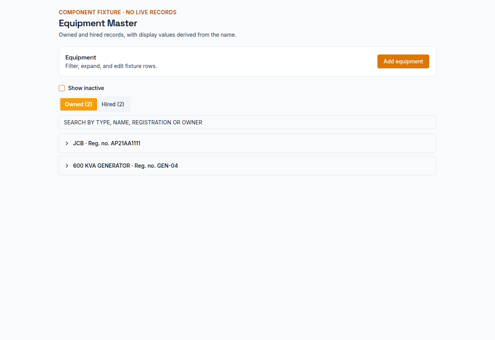
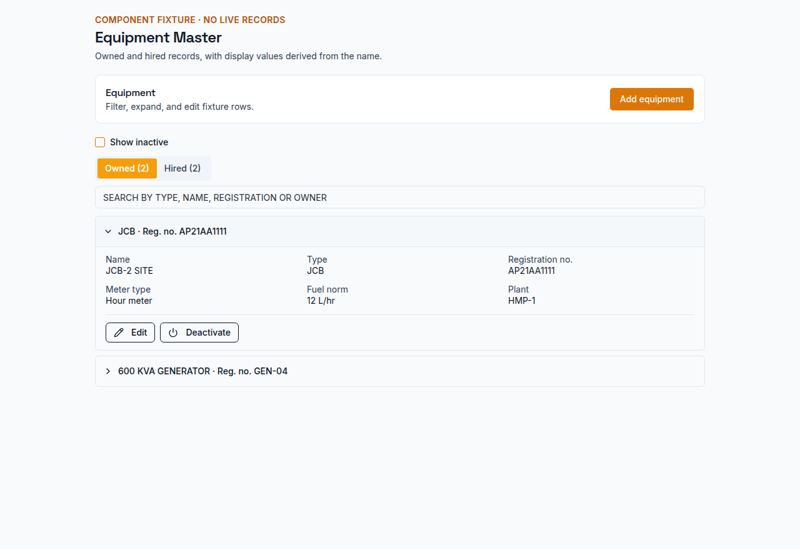
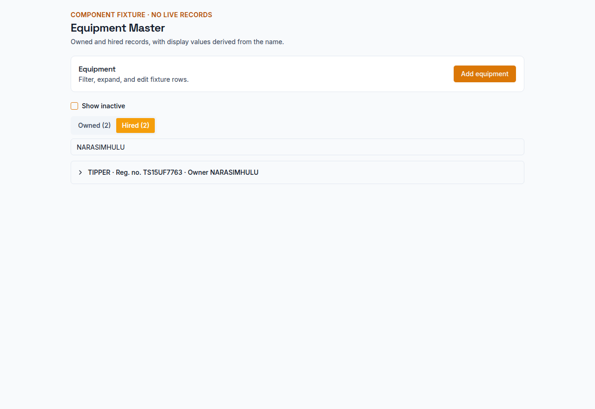
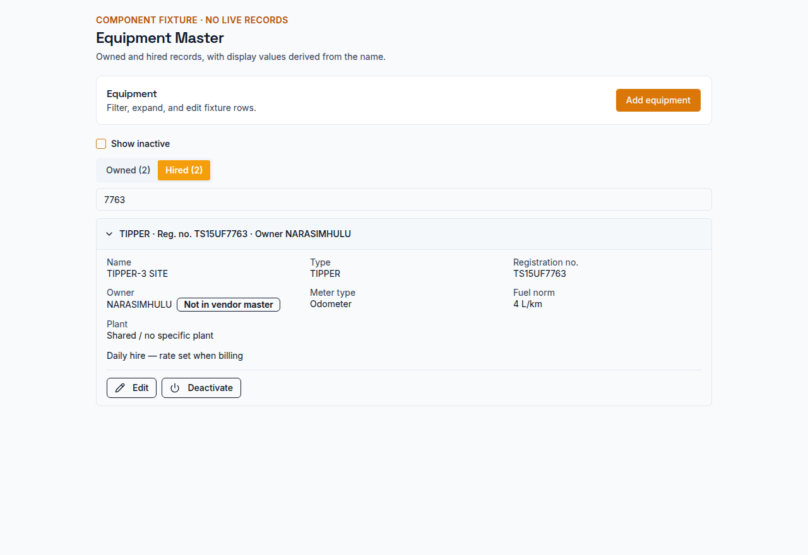
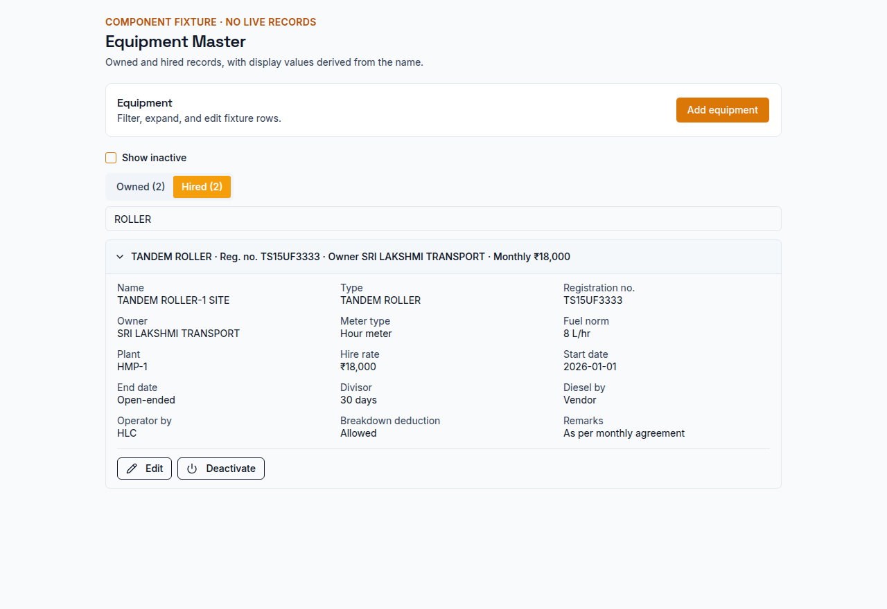
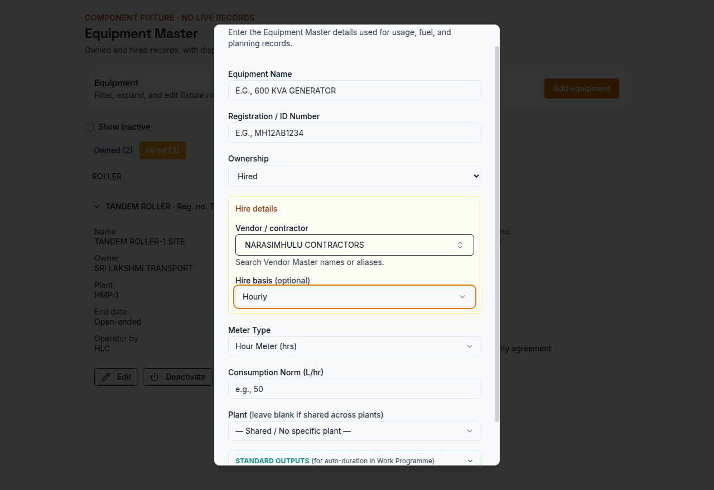
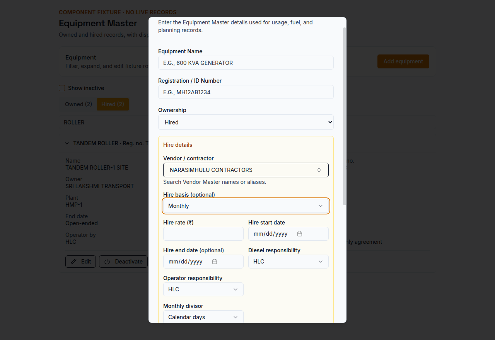

# EQUIP-MASTER-01 — Part A: read-only findings

## Scope and database

This report covers Part A only. The database check connected through the
development `DEV_DATABASE_URL` and confirmed `current_database() = sitelog_dev`.
It used SELECT queries only. Production and its replica were not queried; no
records, schema, or application code were changed. No tests were run.

## 1. Equipment Master screens and fields

**List:** `/masters/section/equipment` renders `EquipmentMasterSection` in
`client/src/pages/Plant.tsx`. It currently has an All Plants / shared plant
filter, a Show Inactive checkbox, and Add Equipment. Each row shows the
equipment label (name, registration number, ownership, meter type), plant or
Shared, consumption norm, and vendor for hired equipment. Inactive records are
marked. Edit, activate/deactivate, and delete controls are on each row.
Equipment type and the full hire terms are not shown in the current list.

**Create:** `client/src/components/EquipmentMasterCreateDialog.tsx` shows:
equipment name; registration / ID number; equipment type; ownership; for hired
equipment, vendor / contractor name, hire basis, rate, start/end dates, diesel
and operator responsibility, monthly divisor (for monthly basis), breakdown
deduction option, and hire remarks; meter type; consumption norm; plant; and
expandable standard outputs and efficiency.

**Edit:** the Edit Equipment dialog is inline in `EquipmentMasterSection` in
`client/src/pages/Plant.tsx`. It shows name, registration / ID, ownership; for
hired equipment, Name in Tally, vendor / contractor name, hire basis, rate,
start/end dates, diesel/operator responsibility, monthly divisor (for monthly
basis), breakdown deduction option, and remarks; meter type, consumption norm,
plant, standard outputs, and efficiency. Unlike Create, Edit has no equipment
type field.

## 2. Current hire-term save rule

Create and Edit currently use the same client-side rule. Any hire basis, rate,
date, remarks, or breakdown-deduction setting makes the form treat hire terms as
being entered. For hired equipment, those terms require a vendor, basis, rate,
and start date; the rate must be above zero; an end date is optional but cannot
precede the start date.

The validation message is:

> Vendor, hire basis, rate, and start date are required when adding hire terms

The Create dialog separately requires a vendor name for all hired equipment.

**Server:** the create route parses the selected fields but has no matching
hire-term refinement. The update route accepts the request body and storage
updates the supplied fields without that validation. Thus the rule is enforced
by the current forms, not by the save endpoints. Later, when a hire statement is
prepared, the server rejects invalid configured terms with:

> Equipment does not have valid configured hire terms

## 3. Equipment identity by name text versus ID

- **DPR entry (Site Entry, Site Edit, Guided DPR):** selecting a master record
  saves its `equipmentId` and a machine-name snapshot. “Other / Unlisted”
  entries save typed machine text without a master ID. Reads prefer the ID-linked
  master name and otherwise display the saved machine text; the save path does
  not automatically resolve a typed name to a master.
- **Unlinked equipment logs:** `equipment_logs.machine` is required while
  `equipment_id` is nullable. The Equipment Needing Identification review
  suggests masters from normalized name or registration text (exact or
  substring), but does not link automatically; a reviewer selects the record.
  The separate duplicate-usage warning compares a typed machine name exactly
  with a master name and only warns—it does not link records.
- **Diesel comparison:** equipment IDs take priority. If an item or log has no
  ID, the comparison resolver matches a normalized equipment name or
  registration only when it identifies exactly one master; ambiguous or missing
  matches remain unassigned. Diesel requirement items store both
  `equipmentId` and `equipmentName`.
- **Vendor-bill equipment pulls:** hired equipment is selected using its
  recorded owner/vendor text or explicit audited vendor identity. Linked DPR and
  plant-usage rows are selected by equipment ID. For older DPR rows with no
  `equipmentId`, the bill pull also searches the machine text for the selected
  vendor-name variants and may include a “site-unlinked” line; this is a text
  fallback, not a reliable equipment-master ID match. Saved bill items otherwise
  carry equipment/source IDs. Legacy equipment-evidence recovery requires a
  unique match on equipment ID, date, site, type, unit, and stable description;
  it does not guess from name alone.
- **Hire statements and their bills:** statements are keyed to `equipmentId`
  (including the unique equipment-and-period constraint). Statement reads,
  bill items, and billing calculations resolve the master by ID, not by name.
- **Equipment and maintenance reports:** equipment-performance records join
  through `equipmentId`; an unlinked log displays its saved machine text and is
  marked unclassified. The identification review uses name/registration only
  to suggest possible records for a person to confirm. Maintenance records and
  equipment filters use equipment IDs.
- **Generator records:** creating an Equipment Usage mirror from an inline
  heating-session entry looks up the master by exact equipment name. A separate
  legacy normalizer compares generator names after removing a trailing
  “GENERATOR” and can update generator-log/heating-session labels; it does not
  use equipment IDs. This report did not run that routine.

## 4. Hired equipment owners not matching a Vendor Master name or alias

`equipment_master` contains 53 hired records: 5 owner texts match a Vendor
Master name, 11 match a Vendor Master alias, and 37 match neither. No hired row
has a blank owner name. The list below groups all 37 unmatched records by the
saved owner text; IDs and equipment names are included. This is an inventory
only—no links or owner text were changed.

| Saved owner text | Equipment records |
|---|---|
| AMIR HUSSAIN | #38 DCM |
| ARESH SARPANCH | #41 WATER TANKER SINGITHAM VILLAGE |
| ARUN | #10 JCB-2 SITE; #24 TRACTOR-BOWSER PULLER |
| ARUN BORENCHA | #27 TRACTOR ENGINE FOR BOWSER |
| ASHOK CONTRACTOR | #7 SOIL COMPACTOR |
| FASI UDDIN | #48 JCB |
| FASIUDDIN | #52 TIPPER; #53 TIPPER |
| GHOUSUDDIN | #23 TRACTOR COMPRESSOR-GHOUSUDDIN |
| MAHABOOB | #40 JCB MAHABOOB |
| MALLESH | #34 TIPPER; #35 TIPPER; #36 TIPPER; #43 TRAILOR MALLESH KOHIR |
| MDFASIUDDIN | #56 JCB |
| MOHAN REDDY | #21 PAVER FINISHER-MOHAN REDDY |
| MOIZUDDIN | #50 JCB |
| NEMALI JAYRAM | #18 TANDEM ROLLER-JAYRAM |
| PRABHU KUMAR CHELMEDA | #6 WATER TANKER |
| RAJU | #26 AIR COMPRESSOR |
| RAMESH | #12 TIPPER-RAMESH |
| RATNAM | #20 TRACTOR-RATNAM |
| SALAHUDDIN | #55 TRACTOR DOZER |
| SALAUDDIN | #5 DOZER |
| SANGANNA | #32 TIPPER; #33 TIPPER |
| SHIVA | #11 TIPPER-SHIVA |
| SRINIVAS KAPPAD | #44 DCM TRUCK |
| SUNDAR | #14 WATER TANKER-2 SUNDAR |
| SUNIL | #51 JCB |
| SURESH | #16 TIPPER-SURESH; #25 TIPPER INTERCARTING |
| SURESH SIGITHAM | #42 TRACTOR ENGINE FOR BOWSER |
| SURESH YADAV | #15 TIPPER-SURESH YADAV |
| VEERANNA | #13 JCB-3 VEERANNA |
| VENKANNA | #49 EXCAVATOR |

## 5. Duplicate registration numbers

There is one duplicate-registration group: **AP21Q7292**, both active hired JCB
records. “DPR logs” counts `equipment_logs` linked by equipment ID; “usage” counts
`equipment_usage`; “bills” counts distinct vendor bills with a linked
`vendor_bill_items.equipment_id`. Hire statements are shown separately.

| Equipment ID | Name | Saved owner | DPR logs | Usage rows | Linked bills | Hire statements |
|---:|---|---|---:|---:|---:|---:|
| 48 | JCB | FASI UDDIN | 2 | 2 | 0 | 0 |
| 56 | JCB | MDFASIUDDIN | 0 | 0 | 0 | 0 |

No records were merged or changed.

## 6. Schema

No schema change is needed for the requested tabs, search, expandable details,
or conditional hire fields. Equipment Master already stores the displayed
values. It has no `vendor_id` column, but explicit equipment-owner links already
use the existing `audit_logs` record (`confirm_vendor_identity`) with the
selected vendor ID and recorded owner name, so the form can use that existing
audited mechanism rather than adding a column.

**Part A is complete. Part B is recorded below.**

## Part B — Equipment Master screen and save rules

### Changes

- Added separate Owned and Hired tabs with their own case-insensitive search over
  the derived machine type, name, registration number, and (for hired rows) saved
  owner text. Inactive equipment stays hidden until “Show inactive” is selected.
- Rows now collapse to a single summary line and expand to show equipment
  details. The displayed Type comes from `canonicalizeMachineType(name)`, not
  the stored `equipmentType` value. Create and Edit do not ask for a type field.
- Monthly hired rows show their saved rate in the summary and their monthly hire
  terms in the expanded detail. Hourly, daily, and trip hire rows show only
  “Hourly/Daily/Trip hire — rate set when billing”; their rate/date fields are
  hidden. Create and Edit require a positive rate and start date for monthly
  hires, and the server enforces the same validation. Edit leaves saved non-monthly
  hire terms untouched when their fields are hidden.
- A name edit that changes the derived type pauses for the requested Save /
  Cancel confirmation. Generator names are read-only with the requested
  explanation.
- The hired owner picker searches active Vendor Master names and aliases. It
  requires an explicit selection for new hired equipment. A changed selection
  stores the Vendor Master name and writes the existing
  `audit_logs.confirm_vendor_identity` record; an unchanged or empty selection
  does not rewrite saved owner text or create a link.
- Added the Inactive badge and activation control inside each expanded row.
  No existing record was changed; record #56 (JCB AP21Q7292) was not edited or
  deactivated.

No schema or database changes were made. Development data and production data
were not queried or modified. Test records and screenshots below are isolated
fixtures; they are not a signed-in live screen.

### Screenshots

These screenshots render the actual Equipment Master components with fixture
records and no database connection.

**Owned, collapsed**

**Owned, expanded**

**Hired search by saved owner**

**Hired search by registration and expanded daily-hire row**

**Expanded monthly-hire row**

**Create hired equipment — hourly**

**Create hired equipment — monthly**

### Tests and build

- Focused Equipment Master, lifecycle, identification, and existing Vendor Master
  identity tests: **5 test files passed, 32 tests passed**.
- Browser fixture verification completed and wrote all seven screenshots above.
- `npm run build`: **passed**.
- The project test workflow also ran the full suite: **5,688 passed, 7 failed,
  3 skipped** across 455 test files. Failures were in
  `arrangementProcurementCorrection.test.ts`,
  `materialReceiptReversal06mD.test.ts`,
  `purchase-indent-pi01.test.ts`,
  `unscheduledReportCredit.test.ts` (three tests), and
  `vendorBillVb15Server.test.ts`; none were in the focused Equipment Master
  tests. These failures were not changed as part of this screen-only batch.
- `npm run check` reports 456 TypeScript diagnostics across 58 project files;
  the production build and focused tests above pass.

**Part B is complete. No publish was performed.**

## Fix before publish — preserve hidden non-monthly hire terms

Edit now sends hire rate, dates, diesel/operator responsibility, remarks,
breakdown setting, and monthly divisor only when the selected basis is Monthly.
For hourly, daily, or trip equipment, the client sends no changes for those
saved terms. The server also ignores hidden hire-term fields on non-monthly
edits, so they remain stored even if an older client sends nulls. Switching
ownership or basis does not clear these values either. The basis itself can be
changed deliberately; hidden rate, date, responsibility, and other terms change
only while Monthly is selected.

This protects two first-bill paths that still depend on Equipment Master terms:

1. The Equipment Hire register's `GET /api/equipment-hire/statements` preview
   and `POST /api/equipment-hire/statements` first-statement creation use the
   equipment's saved rate and dates for every basis, including Daily.
2. The shared Vendor Bills `POST /api/vendor-bills` and `PATCH
   /api/vendor-bills/:id` paths with hire groups use `equipment.hireRate` when
   creating the first hire statement for that machine. An existing draft uses
   its submitted group rate; creating a Vendor Bill from an approved statement
   uses the saved `statement.rate`.

The daily-hire regression fixture is a tipper with saved rate ₹5,000 and start
date. Renaming it leaves all saved hire fields out of the Edit request and the
saved fixture retains ₹5,000 and its dates. A first daily Vendor Bill hire group
then produces a statement and line at ₹5,000.

### Verification

- Focused Equipment Master and Vendor Bill hire tests, run with file
  parallelism disabled: **11 files passed, 116 tests passed**.
- The first-daily-statement regression verifies the saved master rate is used.
- `npm run build`: **passed**.
- The automatic full-suite workflow run on app restart, before the
  `equipmentLabel.test.ts` expectation was updated for the new derived-type
  rows, reported 5,677 passed, 9 failed, and 3 skipped. That full suite was not
  rerun for this focused fix; the updated label test and all 10 other focused
  files pass above.
- No schema or application data changes were made. No publish was performed.
