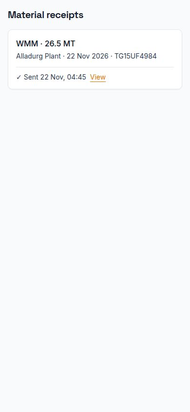
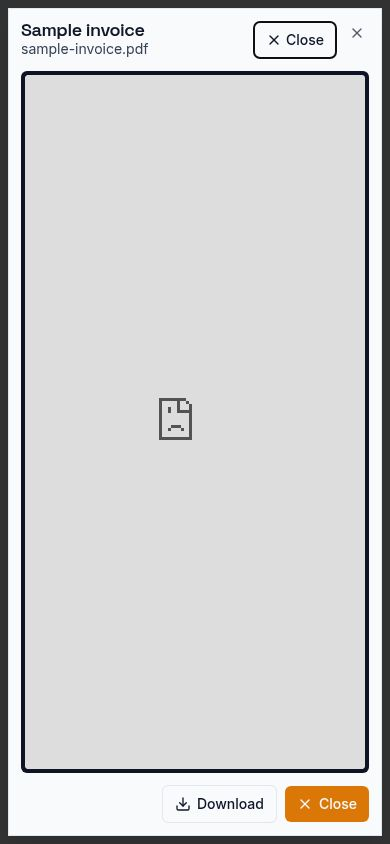

# FIX-UI-01 — Receipt and document viewing

## Changes

- Receipt rows now show **View** whether a receipt was sent or not. It opens the same PDF dialog used after saving, with Close controls at the top and bottom and the appropriate Send / Send again action.
- The shared attachment viewer now keeps PDFs inside the app in standalone mode, with a full-height frame, visible Close controls, and Download. “Open in new tab” remains available in a regular browser tab.
- Images use the phone width and allow pinch zoom and panning.
- Attachment, receipt, purchase-order, challan, and report links that open documents now use the in-app viewer in standalone mode. Browser-tab behavior is preserved. Spreadsheet exports remain downloads rather than opening an empty tab in the installed app.
- No schema or data changes. Not published.

## Screenshots

Receipt list with View at phone width:

Sample invoice PDF in the standalone viewer at phone width:

The screenshot capture shows the in-app PDF frame and its controls, but not the PDF page itself. The focused test verifies that the PDF iframe is mounted and that Close and Download remain available.

## Verification

- Focused receipt-action and attachment-viewer tests: 14 passed.
- Full test suite: 5,889 passed, 3 skipped across 486 test files (484 passed, 2 skipped).
- `npm run build`: passed.
- `npm run check`: the default Node heap ran out of memory. With a larger heap, TypeScript reported numerous project-wide diagnostics; none pointed to the new viewer/link components. The Vite production build passes.
