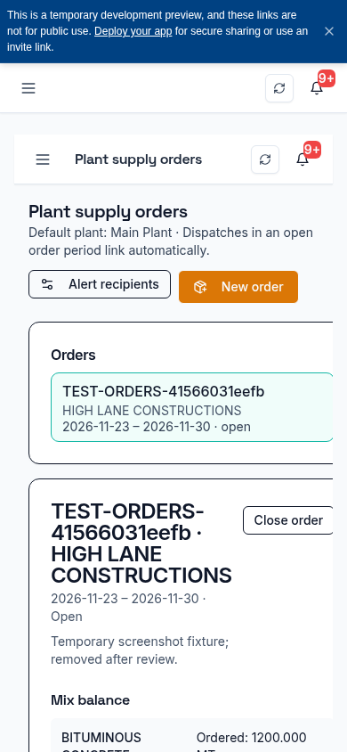
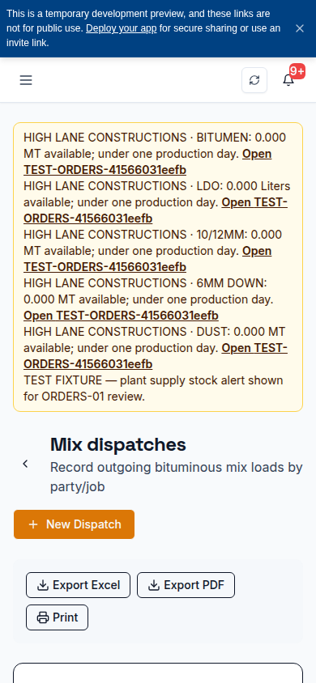

# ORDERS-01 — Plant supply orders and stock alerts

## What changed

- Added plant supply orders under HMP Operations. An order records a party, optional site, order number, dates, remarks, one or more mixes, ordered MT and optional planned MT per day. Material scope defaults to HLC supplies and can be changed to Party supplies.
- Dispatches created for the same party during an open order's date range link to that order automatically. Dispatches outside an order continue as “No order”.
- The order screen shows ordered, dispatched and balance MT per mix; material needed for the remaining mix, stock for its chosen scope and any shortage. HLC shortages open the existing purchase-indent form with material and quantity prefilled; Party shortages are labelled “Party to supply”.
- A short party-stock dispatch is still saved. The shortfall is recorded as borrowed from HLC, with truck and time. An Owner or P&M In-charge can approve it or record “Party will replace” with a note. Later receipts can be linked as replacements; the remaining owed quantity is shown on the order and Party Statement.
- Added running-low, exhausted and borrowing alerts to the order screen and plant dispatch log, plus the app bell list. Running low means less than one production day remains and is deduplicated per party, material and day. Exhausted alerts use the party-stock ledger balance crossing from positive to zero or below.
- Added the Owner-only alert-recipient settings page. The daily 7:00 AM IST summary includes each open order’s mix balances and material days remaining; planned daily production is used when set, otherwise the recent three production days are used.

## Permissions and recipient mapping

- Added the `plant_supply_orders` and `plant_supply_alert_settings` permission entries. The new pages are Owner-only by default.
- Plant in-charge maps to **P&M In-charge**. Plant operator does not exist as a role in `sitelog_dev`, so the default uses active named users assigned to **Plant Engineer** (one active user). Project manager maps to **Project Manager**; plant head maps to **Project Head**. Borrowing alerts also go to all active Owners.
- Owners and P&M In-charge can close or reopen orders. Borrowing decisions are limited to Owners and P&M In-charge.

## Schema and development checks

- Migration `migrations/0060_plant_supply_orders.sql` was applied to both development databases: `sitelog_dev` and the Publish-facing `heliumdb`.
- It adds nullable `truck_dispatches.supply_order_id` with a foreign key, and seven tables: `plant_supply_orders`, `plant_supply_order_lines`, `plant_supply_order_material_scopes`, `plant_supply_borrowings`, `plant_supply_borrowing_events`, `plant_supply_borrowing_replacements`, and `plant_supply_alert_deliveries`. The migration is additive; no existing dispatch or stock rows were updated.
- No existing users, permission assignments, dispatches, stock, ledger, receipts, indents or purchase orders were changed.
- The running development app on `sitelog_dev` started with readiness `ready: true` (2,362 columns checked). The direct readiness check on `heliumdb` returns `STARTUP_ACCESS_MIGRATION_REQUIRED` because its access-migration review marker is missing. This is separate from migration 0060. I did not add the marker or alter permissions, because that is outside this batch and could change existing access.
- No production database or replica was queried or changed. No publish was performed.

## Tests and build

- Focused supply-order calculations: **6 passed**.
- Full suite: **493 test files passed, 2 skipped; 5,953 tests passed, 3 skipped; 0 failures**.
- `npm run build`: **passed**.
- `git diff --check`: **passed**.

## Temporary review fixtures

For the phone screenshots, I created a temporary development Owner login, order, and alert using development party/mix references. The normal login and device-approval flow was used. The temporary user, session/device rows, order, and alert were deleted afterward; a read-only check confirmed zero matching temporary rows remain in `sitelog_dev`. No existing dispatch, stock, ledger, receipt, indent or purchase-order record was changed.

### Order screen — phone width

### Plant log alert — phone width

The development workflow has VAPID keys unset, so actual push delivery was not exercised. The alert records and in-app display paths were tested; the existing push-delivery call remains wired for environments with push configured.
