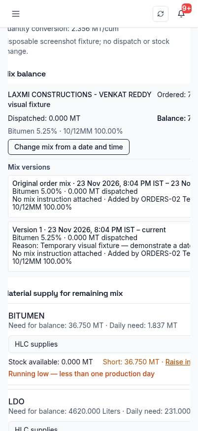

# ORDERS-02 — Plant supply order updates

## Changes

- Open orders can now be edited by Owners and P&M In-charge users. The form covers the order period and number, work details, MT-per-cum factor, remarks, mix quantities, planned daily quantities, and added mix lines.
- The server refuses a period that excludes linked trucks, a quantity below dispatched tonnage, or removal of a mix line that has dispatches. Blank mix rows are ignored; partially completed rows still fail validation.
- Every changed order field and mix line is recorded in Order history with the actor and old/new values. Order attachments can be added later; only Owners can remove them, and removal is recorded.
- A mix change creates an immutable, dated version with its bitumen percentage, aggregate shares, reason, and optional instruction attachment. Dispatches resolve a version using the dispatch date/time in IST. Existing dispatches keep their saved version when edited; a legacy dispatch without a saved version is resolved from its original date/time. A new version cannot be earlier than the latest linked truck. A truck exactly at the effective time stays on the prior version; only later trucks use the new version.
- The order view shows the version timeline, dispatch tonnage and per-version allowance/actual totals. Remaining material need uses the latest version. The instruction-attached status is shown for each version.
- Owner accounts appear in alert recipient choices and are selected by default for Running low, Exhausted, and Borrowed. Owners can opt out of Running low and Exhausted; Borrowed still always includes Owners. The 7:00 AM summary follows the saved Running low recipients.
- Mix lines can be removed only when no truck is linked. Dispatch Log rows refresh automatically every three seconds after edits, retries, or status changes.

## Development schema and startup

Migration `0062_plant_supply_order_versions.sql` was applied additively to both development databases:

- `sitelog_dev` (`DEV_DATABASE_URL`)
- `heliumdb` (the Publish-facing development database, `DATABASE_URL`)

It creates `plant_supply_order_mix_versions` and `plant_supply_order_mix_version_components`, their indexes, and the nullable `truck_dispatches.supply_order_mix_version_id` foreign-key column and index. No production database was accessed.

After the final code changes, the development app restarted successfully. Read-only startup readiness reported `ready: true` and checked 2,401 columns.

## Verification

- Focused plant supply order and dispatch tests: **4 files, 25 tests passed**.
- Calculation and version-selection tests cover 300 MT at 5.0% = 15.0 MT bitumen, 120 MT at 5.25% = 6.3 MT, and 21.3 MT total. They also verify a saved earlier version remains selected when an old dispatch is edited.
- Build: `npm run build` passed.
- Full test suite: **494 files passed, 2 skipped; 5,961 tests passed, 3 skipped; 0 failures**.

## Phone-width screenshot

The screenshot shows an order with its original mix and a later 5.25% mix version. It was created with a temporary development Owner account and disposable order; both were deleted after capture. No dispatches were created for the screenshot, and no stock or ledger entries were written.

## Skipped

No real dispatch was entered into the development database for the 300 MT / 120 MT scenario, to avoid writing stock or ledger rows. The amounts and version-selection behavior are covered by isolated calculation tests. No production data, existing dispatch, stock, or ledger record was changed.
