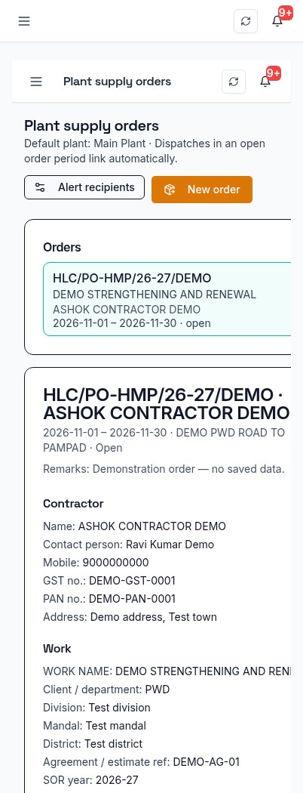

# ORDERS-04 — Clean supply order view

## What changed

- The order view now gets contractor details from Party master and work details from Site master. Empty master fields are omitted; the empty states and links to edit each master are shown when needed.
- Removed the old order-level work details, conversion factor, material-use breakdown and remaining-mix calculations from the view, edit form and printout. Existing saved legacy values are left untouched.
- Kept order number, period, mix lines, remarks, DispatchPro status and retry, documents, alerts, history, and mix changes. Material supply scope still uses the existing audited route and is disabled for closed orders.
- The order API now includes `materialUsage` only for users with the “Norm vs actual (savings)” view permission. This applies to order lists and detail responses, including nested mix versions. The Owner report itself was not changed.
- The print layout uses the same cleaned master details and does not include actual-use figures.

## Checks

- Focused order screen and API tests: **29 passed** across 3 test files.
- Build: `npm run build` passed.
- Full test suite: **6,033 passed, 3 skipped, 0 failed** across 505 passed test files and 2 skipped.
- Development app restarted successfully. Read-only startup readiness reported `ready: true`.
- No schema or migration changes. No order, mix, dispatch, stock, ledger, bill, permission or other existing business records were changed. No production database was accessed.

## Screenshot and temporary access

The phone-width screenshot below uses a browser-only demo order response; it did not create or change a saved order.

The print stylesheet was checked in print emulation: the cleaned print view is visible and does not contain actual-use or allowance figures.

A temporary Owner was created in `sitelog_dev` solely to capture the signed-in view, then deleted. A read-only check confirmed that the temporary user, sessions and devices were all removed.
