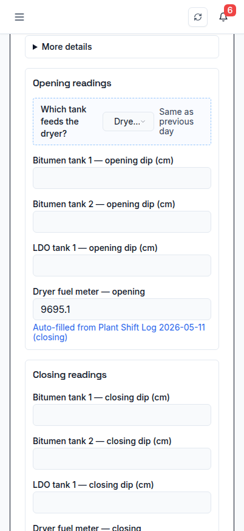
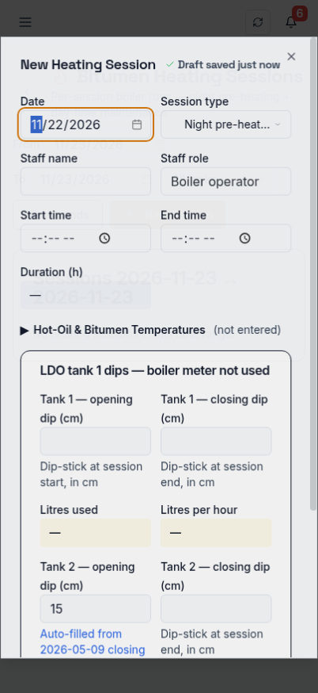
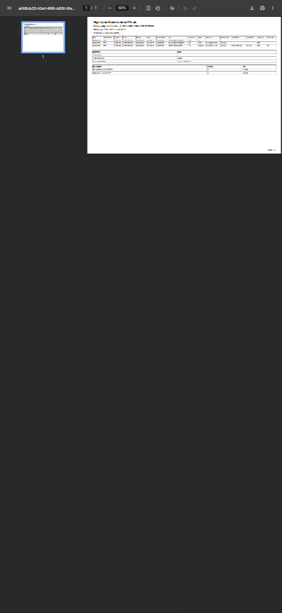

# PLANT-03 — Plant log and dispatch improvements

## Changes

- Removed the three quick buttons from the HMP shift log. “Plant stopped” opens the idle-event form directly with the current time.
- Added the Owner setting for production DG selection. Only selected, active generators appear in the plant log and their existing Equipment Usage rows are reused.
- The 600 KVA generator exists in development but is inactive, so it is not available in the picker. The equipment master was not changed.
- A new shift log carries forward the dryer-feed tank selection from the latest earlier log for that plant and labels it “Same as previous day.”
- Added the Owner boiler-fuel setting. In dips-only mode the boiler meter is hidden; Tank 1 dips drive the usage summary, and heating sessions show dip-based litres and litres per hour.
- Fixed the routed heating-session page (`PlantHeatingSessions.tsx`) as well as the dialog component so dips-only mode works in the form operators actually open. Working-meter mode remains unchanged.
- Dips-only mismatch screens identify that the boiler meter is not used. The daytime heating-session label changed without changing the stored session type.
- DispatchPro status text is shorter and gives a plain retry reason or an Owner link when a party is not linked. Dispatch sending and retry behavior were not changed.
- Dispatch Log and party statement exports support the selected party, mix, and date range, with reconciliation columns, time durations, totals, and a black-and-white landscape PDF.

## Migration and safety

Migration `0059_plant_dg_boiler_settings.sql` adds only:

- `plant_settings.dg_production_equipment_ids` — nullable text.
- `plant_settings.boiler_fuel_meter_mode` — text, default `working`, not null.

Applied to both development databases: `sitelog_dev` and the Publish-facing development database `heliumdb`. The columns were already present, so the idempotent re-apply skipped them. No production database was queried or changed.

The app restarted with read-only startup readiness `ready: true` (`2,288` columns checked). Development screenshots used a temporary Owner account that was deleted afterward; the test setting was restored to `working`. No existing shift logs, heating sessions, equipment usage, dispatches, receipts, or LDO records were changed. The PDF screenshot uses synthetic rows in the browser only.

## Screenshots

- Shift-log opening readings, dips-only setting: 
- Heating session with Tank 1 dips: 
- Dispatch export PDF, first page: 

## Verification

- Focused plant tests: 6 files, 18 passed.
- Full suite: 491 test files passed, 2 skipped; 5,926 tests passed, 3 skipped, 0 failed. Tests ran against a disposable database loaded with the development schema only.
- Plant Stock navigation hotfix checks: 8 passed.
- `npm run build`: passed. The build emitted only the existing large-chunk and Browserslist-age warnings.
