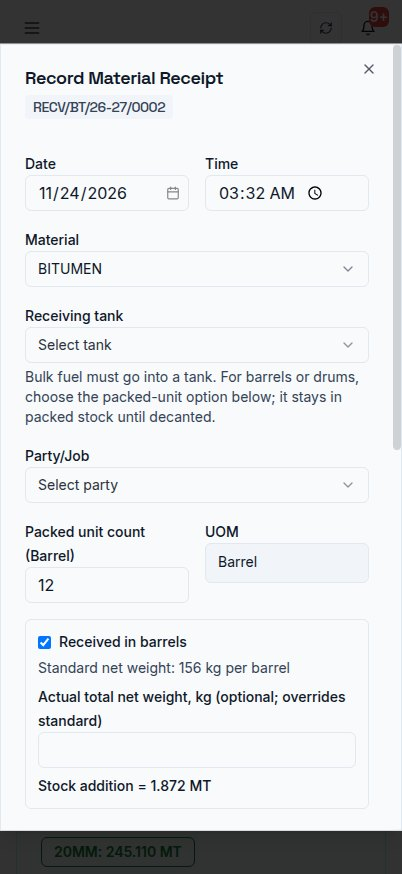

# STOCK-02 — Stock, packed receipts, and material forms

## Part 1 — Stock unit and ledger

- Stock summaries use the material's stock unit and convert ledger rows before totaling. Legacy tonne labels (`Ton`, `Tonne`, `T`) are read as MT; quantities are not converted by changing the label.
- Plan vs Actual, Procurement stock, transfer balances and Stock Summary use ledger-derived balances. Aggregate MT and approximate CFT are shown where a configured delivered weight allows it.
- Transfers convert into each party balance's unit. The receiving party is not credited with a CFT quantity labelled as MT.
- Stock Summary includes a “Used by mix” breakdown for aggregate use.

## Part 2 — Stored balances and dispatch deletion

- Dispatch deletion restores stored balances in the same transaction that removes its ledger rows. `tests/stock02Packed.test.ts` covers this path.
- Plant Stock has an Owner-only “Match stored balance to ledger” review: it previews only mismatched rows, requires typed confirmation, changes stored balances only, and writes an audit record. It was not run on existing data.
- Differences smaller than 0.01 MT or 1 L are treated as rounding. Plant Stock notices are collapsed into one short line; the stored-balance warning is Owner-only.
- No repair, rebuild, reassign, reconciliation, or balance-matching action was run in this finishing work.

## Part 3 — Open-order summaries

- The HMP Operations page shows an Open orders card with problem materials, stock, shortages or days remaining; tapping an order opens it.
- The same order figures are surfaced in the plant shift log, truck-entry form and Owner dashboard.
- The development API currently returns zero open-order summaries, so this report does not include an Open orders screenshot.

## Part 4 — Dispatch Log refresh

- The Dispatch Log refreshes every 10 seconds while a visible truck is waiting to send, and for 60 seconds after an edit or Retry. Otherwise it refreshes on page open or manual refresh, not every three seconds.
- The polling tests cover both active and idle states.

## Packed stock and LDO

- Any plant material can have a packed unit profile. Bitumen/emulsion use a standard net weight; LDO/diesel can use a standard volume in litres.
- Packed receipts record the pack count and calculated stock quantity, with an optional actual-weight override. Bulk fuel receipts still require a tank.
- Decant transfers packed quantity into a selected tank while preserving party ownership. LDO decants record date and time as a tank receipt for PLANT-04 calculations.
- Packed stock contributes to supply-order availability; dispatches and plant LDO use continue to draw from tanks only.
- LDO stock screens and exports show Tank 1, Tank 2, Packed and Total in litres. The earlier no-tank receipt format remains unchanged.
- The old development rows found were EMULSION / Barrels: 2 receipts in `sitelog_dev` and 1 in `heliumdb`. They were not converted or edited.

## Tank labels

Labels now follow the material while stored tank numbers remain unchanged:

- LDO: “Tank 1 (small vertical)” and “Tank 2 (big horizontal)”.
- Bitumen: “Bitumen tank 1/2”.
- Emulsion: “Emulsion tank 1/2”.
- Diesel and other materials: “Tank 1/2”.

This is used in material receipts, pending receipts/GRN, material issues, opening stock, transfers, decant, Plant Stock lists and exports, and dispatch tank selection. LDO-specific flow and shift screens retain the LDO tank names.

## Material Master fields

- The category is selected before profile fields appear. Without a category, the form shows the category prompt and only the basic fields: name, category, default UOM, procurement route and aliases.
- Aggregate/granular materials show volume-to-weight conversion and compacted/loose density, compaction, loose factor and wastage.
- Bitumen/emulsion show MT, packed unit and net kg, without density fields. LDO/diesel show litres and packed unit volume, without density fields.
- Store, spares, electrical, consumable and other categories show only the basic fields. The add-material forms in Purchase Indent and GRN use the same category-specific fields.
- Values in hidden profiles are retained when saving. Existing UOM labels not in the standard picker are displayed as-is rather than appearing blank.
- The only uncategorized material found in each development database is ID 11, `12MM AGGREGATE`.

## Development schema and data safety

Migrations `0063_packed_stock.sql` and `0064_ldo_packed_receipt_tank.sql` are additive and were applied to both `sitelog_dev` and the Publish-facing development database, `heliumdb`:

- `0063` adds packed-unit/profile columns to `plant_materials`, packed-receipt fields to `material_receipts` and `pending_plant_receipts`, packed position/count fields to `stock_ledger`, and creates `plant_stock_decants` with two indexes.
- `0064` adds `pending_plant_receipts.tank_number` and `plant_stock_decants.time`.
- The tank-label and conditional-form finish adds no schema change. Both development databases had the required columns; startup readiness passed with `ready: true` and `checkedColumns: 2427`.

No production database or replica was accessed. No existing receipt, dispatch, ledger, stock balance or material record was changed. Temporary development Owner accounts used for screenshots were deleted with their sessions and devices.

## Verification

- Focused run: 6 files passed, 64 tests passed. This included packed-stock, LDO accounting, stock page, purchase-indent material form, compacted/loose form and material-master category/tank-label tests.
- Full suite, run once after the final code edits: 496 files passed, 2 skipped; 5,984 tests passed, 3 skipped, 0 failed.
- `npm run build`: passed.
- One phone-width screenshot is included. It shows a bitumen receipt entered as 12 barrels at 156 kg each (1.872 MT). The packed profile in this screenshot was supplied as a browser-only fixture; no receipt or material profile was saved.

No publishing was performed.
